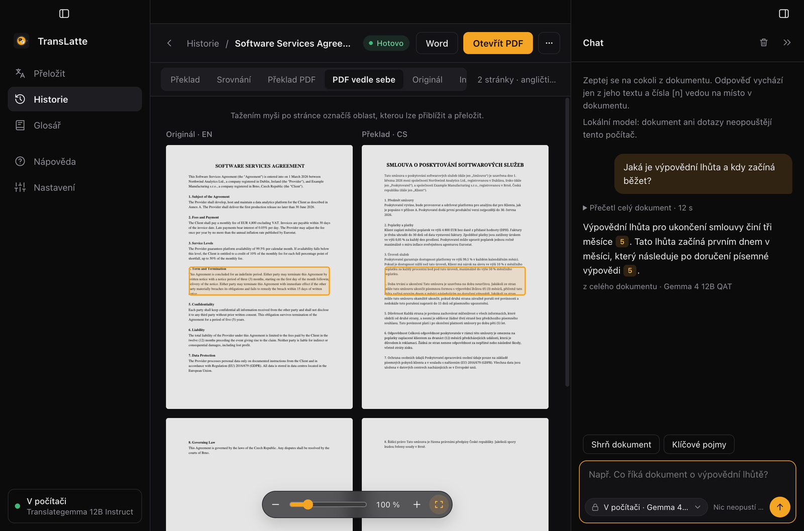
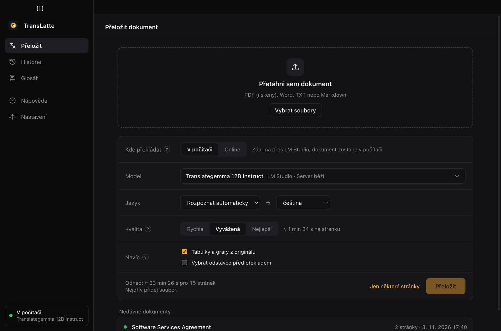
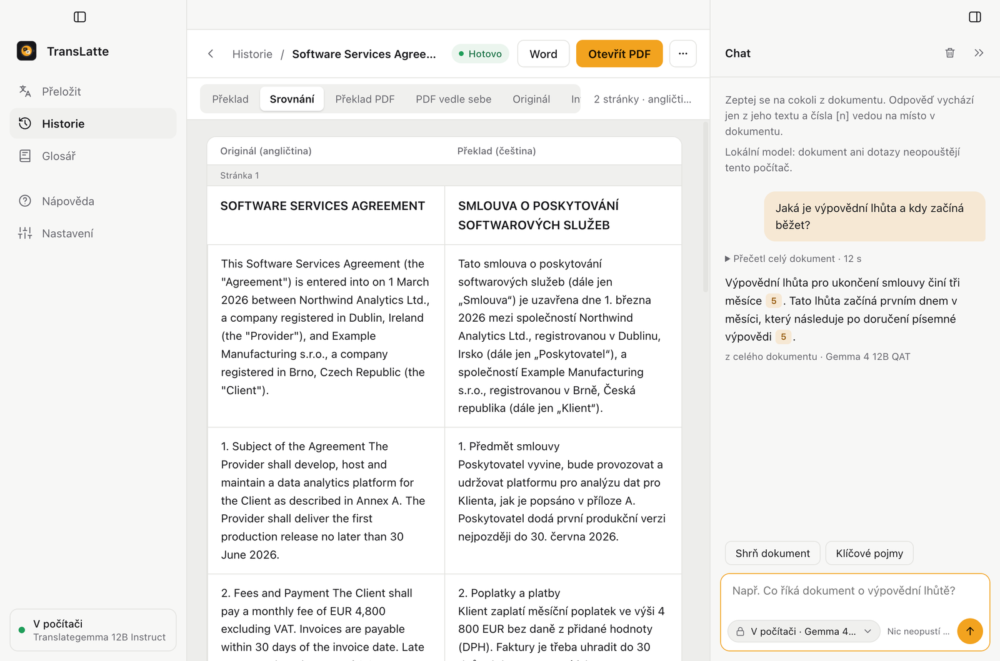

<p align="center"></p>

# TransLatte

**Translate documents, keep their layout, and ask them questions. Privately on your own computer, or online for a few cents.**

TransLatte translates PDFs (including scans), Word, TXT and Markdown files into a Word document, Markdown and a translated PDF that looks like the original. Then you can **chat with the document**: ask what a contract says about termination, what an author thinks about management or what a law requires, and get an answer **with sources** that highlight the exact passage in the original and in the translation.

It runs either **for free on your own computer** (models in [LM Studio](https://lmstudio.ai), nothing leaves your machine) or **online for a few cents** through [OpenRouter](https://openrouter.ai).



## Who it is for

- **Companies and legal teams:** understand contracts, terms, tenders and policies written in another language. Ask *“What is the notice period and when does it start?”*, *“Is liability capped?”* or *“Where is the data stored?”* and jump straight to the clause. With local models, **confidential documents never leave the computer**: no cloud, no third-party processing, no subscription.
- **Students and researchers:** read papers in a foreign language for (almost) nothing, keep citations and footnotes, ask the paper for its main argument and get page references you can put in your own work.
- **Anyone who works with foreign documents:** manuals, reports, letters, scans.

> TransLatte helps you find and understand what a document says. It is not legal advice: always check important answers against the cited text.

## Why TransLatte

- **Private by design.** Local mode runs entirely on your computer. Translation, the document chat and all files stay on your disk.
- **Answers you can verify.** Every claim in a chat answer links to the paragraph it comes from; one click highlights it in both PDFs side by side.
- **Built for students and small teams on a budget.** Paid translators such as [DeepL Pro](https://www.deepl.com/pro) are monthly subscriptions, and document translation is limited on the cheaper plans. TransLatte has no subscription:
  - **Locally it costs nothing.** The models run on your computer.
  - **Online you pay only for what you use.** With the recommended model (DeepSeek V4.1 Flash) a 15–20-page article costs around **$0.02 (≈ 0.5 CZK)** to translate, and a question in the chat costs a fraction of a cent. A $10 OpenRouter credit is enough for hundreds of articles.
- **Made for academic and professional texts.** It keeps paragraphs, headings, footnotes, citations, links and tables, fixes typical machine-translation errors and respects your glossary of technical terms.
- **You see what you'll pay.** The cost is estimated before you start (in USD, CZK or both) and the real cost is shown when the job finishes.

> Prices are approximate and depend on the model and the document; check current prices of paid services on their websites.

## Features

- **PDF in, PDF out:** a translated PDF with the original layout, plus Word (.docx) and Markdown. Works with digital PDFs, scans (OCR), password-free encrypted PDFs and multi-column journal and magazine layouts.
- **Chat with the document:** a side panel next to the document, like NotebookLM. Answers come only from the document, with numbered sources that highlight the passage in the original and the translated PDF. You see what the model is doing (searching keywords, which pages it found, writing the answer) and the answer is written as it arrives. Quick actions **Summarize** and **Key terms**. Choose the model right in the chat: on your computer or online.
- **Locally or online:** switch on the home screen between local models (free, private) and online models via OpenRouter (fast, pay per use).
- **Tables and figures from the original:** a table or chart with a caption (Table 1, Figure 2…) can be kept exactly as in the original as an image; only the caption is translated.
- **Pick what to translate:** choose a page range or tick individual paragraphs; translate more later.
- **Check and fix:** flags untranslated words, likely typos, missing glossary terms and truncated sentences, and fixes them.
- **Glossary:** binding translations of technical terms used in every job.
- **Read comfortably:** translation, paragraph-by-paragraph comparison, translated PDF, both PDFs side by side and the original. Zoom with a pinch, Ctrl/Cmd + scroll or the zoom bar, and drag over any area of a page to translate it separately (e.g. a chart).
- **Queue:** add several files at once; they are translated one after another in the background.
- **Clean interface:** dark and light theme (or follow the system), collapsible sidebar and chat, Czech and English, macOS and Windows.

<table>
  <tr>
    <td></td>
    <td></td>
  </tr>
  <tr>
    <td align="center">Translate: where, which model, which languages</td>
    <td align="center">Comparison of original and translation (light theme)</td>
  </tr>
</table>

## How the document chat works

The chat uses **retrieval-augmented generation (RAG)**: the model answers from the document, not from its memory.

1. **Passages.** After translation the document is already split into paragraphs. Each one knows its page and its exact position on the page, in the original and in the translated PDF.
2. **Short document → whole text.** If the document fits into the model's context (about 10 pages locally, about 130 pages online), the model simply reads all of it. That is the most accurate option.
3. **Long document → search first.** The model turns your question into keywords in both languages (so you can ask in Czech about an English text). A full-text search (BM25 over the original and the translation, tolerant to Czech word endings) picks the most relevant paragraphs together with the heading of the section they belong to.
4. **Answer with sources.** The model gets only those passages and is told to answer strictly from them and cite each claim. Citations pointing to passages it was not given are removed automatically. If the answer is not in the document, it says so.
5. **Verify.** Click a source number and TransLatte opens the PDFs side by side and highlights the passage in both.

The conversation is stored with the job, so you can come back to it later.

## What you need

- **macOS** (Apple Silicon or Intel) or **Windows 10/11** (x64 or ARM).
- **Online mode only:** any such computer and an [OpenRouter](https://openrouter.ai) account with a little credit. No LM Studio and no powerful hardware needed.
- **Local mode:**
  - a Mac with 16 GB+ memory, or a PC with an 8 GB+ VRAM graphics card and 16 GB+ RAM (see [Hardware requirements](#hardware-requirements));
  - about 20 GB of free disk space for the models;
  - **LM Studio** with the models downloaded (see below).

## Hardware requirements

The models run on the GPU. Only one model is in memory at a time; the app swaps them as the translation moves through its stages. Each 12B model needs roughly 9–11 GB: the model file (7–8 GB) plus room for the context, because the app uses a 16k-token context and sends up to 4 requests at once.

| Computer | How it runs |
| --- | --- |
| Apple Silicon Mac with 24 GB+, PC with 16 GB+ VRAM | Recommended; the model fits entirely with room to spare. |
| Mac with 16 GB, PC with 12 GB VRAM and 16 GB RAM | Works. Avoid other heavy apps while translating. |
| PC with 8 GB VRAM and 16–32 GB RAM | Works, but slower; part of the model runs from RAM. |
| PC without a dedicated GPU, Mac with 8 GB | Not suitable. On the CPU alone a few pages take tens of minutes. |

- **Mac:** the GPU shares memory with the system and macOS gives it roughly two thirds to three quarters of it, so 16 GB is the minimum. Intel Macs with AMD graphics have not been tested.
- **Windows:** LM Studio splits the model between GPU and RAM on its own. If a model fails to load or the system becomes unusable, open the model settings in LM Studio (**My Models** → gear icon next to the model) and lower **GPU Offload**. Fewer layers on the GPU means less VRAM but slower translation.
- **Weaker and stronger machines:** TranslateGemma also comes in 4B (for 6–8 GB VRAM, lower quality) and 27B (for 24 GB VRAM, better quality). After downloading, select it in **Settings → Translation on this computer**. These sizes have not been tested with TransLatte yet.

These requirements are estimates. They have been verified on a 16 GB Apple Silicon MacBook Air.

## Installation

### 1. LM Studio and models (local mode only)

1. Download and install LM Studio from <https://lmstudio.ai> and run it once.
2. Open the model search in LM Studio (magnifier icon on the left) and download these models:

   | Purpose | Model (search in LM Studio) | Variant | Size |
   | --- | --- | --- | --- |
   | Translation | `mradermacher/translategemma-12b-it-GGUF` | Q4_K_S | 7.8 GB |
   | Fixes, document context and tables | `google/gemma-4-12b-qat` | Q4_0 | 7.2 GB |
   | Page reading (OCR) | `sahilchachra/Unlimited-OCR-GGUF` | Q8_0 | 3.9 GB |

   For Fast mode on digital PDFs the first two are enough. The OCR model is needed for scans and for Balanced and Quality modes.
3. You don't need to load models or start the server yourself. TransLatte starts the server and loads models on its own, always only the one it currently needs.

### 2. TransLatte

Download the installer from [Releases](https://github.com/Molyn597/TransLatte/releases).

- **macOS:** `TransLatte-…-mac-universal.dmg`. Open it and drag TransLatte to Applications. The app is not signed with an Apple certificate, so the first time **right-click → Open** and confirm.
- **Windows:** `TransLatte-…-win.exe`. If Windows shows "Windows protected your PC", click **More info → Run anyway**. The app installs for your user only and creates a desktop shortcut.

### 3. First run

A short welcome guide asks whether you want to translate locally or online; you can change it any time on the home screen. For online mode paste your OpenRouter API key in **Settings** and you're done.

The connection status (LM Studio or OpenRouter and the active model) is shown at the bottom of the left sidebar; click it for details. In **Settings** each role (OCR, translation, fixes) has a model selected. If you downloaded the models from the table, everything is set. Change the server address (`http://localhost:1234`) only if LM Studio runs on another port or machine. The app language (Czech or English, by default following the system) can be changed in **Settings → Appearance**.

## How to translate

1. On the **Translate** tab, drop files (PDF, DOCX, TXT, MD) into the window or click **Choose files**.
2. Choose **where** to translate (on your computer or online), check the **model** and the **languages**. Locally you can also pick the **quality** (Fast, Balanced, Best); online always uses the best mode, which costs only one extra short request. Optionally keep **tables and figures from the original**, **pick paragraphs** before translating or translate **only some pages** (e.g. `1-5, 8`).
3. Check the estimate and click **Translate**.
4. Finished translations are in **History**. The document detail has a fixed bar with **Word**, **Open PDF** and a **⋯** menu (save as, show in folder, re-typeset the PDF, translate again, delete) and these tabs:
   - **Translation**: the translated text only.
   - **Comparison**: original and translation paragraph by paragraph. The **N to review** link jumps to places worth checking.
   - **Translated PDF** and **PDFs side by side**: the translated PDF with the original layout, on its own or next to the original.
   - **Original** and **Information** (models used, time, cost, notes).
5. Open the **chat** with the button in the top right corner and ask anything about the document.

The **Help** tab explains everything in more detail; the “?” next to each option jumps to the right section.

### Quality (local mode)

| Quality | What it does | When to use |
| --- | --- | --- |
| **Fast** | Takes text straight from the PDF, OCR only for scanned pages. Only flags errors. | Ordinary digital PDFs; the default. |
| **Balanced** | OCR of all pages (better paragraph order and tables), checks and fixes errors. | Complex layouts, tables. |
| **Best** | Also reads the document context (topic, author and their grammatical gender) for more accurate fixes. | Texts that matter. |

## How translation works

1. **Extraction:** text and page layout (paragraphs, headings, tables, links) are read from the PDF. Headers, footers and page numbers are skipped. Scanned pages are read by the OCR model.
2. **Translation:** TranslateGemma (or the online model) translates paragraph by paragraph, several requests at once. Dates like `03-10-2014` are first rewritten into an unambiguous form so day and month don't get swapped.
3. **Check:** typical errors are found without a model: untranslated words, missing glossary terms, Czech prepositions (se/ze, ke/ve), spelling via a Hunspell dictionary, and truncated or repeated sentences. The Czech dictionary is downloaded on first use.
4. **Fix:** Gemma rewrites only the paragraphs with errors and leaves the rest alone.
5. **Output:** a Word file, Markdown and, for PDFs, a translated PDF. In it the original text is covered with the background colour, the translation is set in the same place and links stay clickable.

Jobs, outputs and chat history are stored in the app folder:

- macOS: `~/Library/Application Support/TransLatte/jobs`
- Windows: `%APPDATA%\TransLatte\jobs`

## Online models (OpenRouter)

Choose **Online** on the home screen and paste your [OpenRouter API key](https://openrouter.ai/keys) in **Settings**. The key is stored encrypted with the operating system's secure storage and is never written to the settings file.

- **Cost:** you pay only for what you translate, from your OpenRouter credit. Measured with DeepSeek V4.1 Flash: about $0.001 per page, i.e. roughly $0.02 for a 15–20-page article. The estimate is shown before you start and the real cost after the job; prices can be shown in USD, CZK or both.
- **Models:** in **Settings** pick a model from the OpenRouter catalog (with prices and a cost estimate per article; refresh the list any time). The default is `deepseek/deepseek-v4.1-flash` (best Czech in our comparison of eight cheap models); `google/gemini-3.1-flash-lite` is a faster alternative at about twice the price. Models ending in `:free` cost nothing but are slow (one request per ~3 s), have daily limits and the provider may use your data.
- **Privacy:** the text of your documents (and page images when OCR or table repair runs) is sent over the internet to the model provider. The same applies to the document chat when you choose an online model in it. Use local mode for sensitive documents.

## Glossary

On the **Glossary** tab you set binding translations of technical terms (e.g. *performance review → hodnocení výkonu*). After translation the check warns when a term is missing and the fix step adds it.

## Troubleshooting

- **“LM Studio is not running and its “lms” command was not found”**: LM Studio is not installed or has never been started. Start it and try again.
- **“Could not load the model …”**: the model is not downloaded or doesn't fit in memory. Check in LM Studio that it is downloaded, close heavy apps, or lower GPU Offload (see [Hardware requirements](#hardware-requirements)).
- **Translation is slow or slows down over time:** laptops without active cooling throttle under long load. Plug in the charger and translate in smaller parts.
- **“The translation did not fit into the original space on page N”**: Czech text tends to be longer. The translated PDF uses a smaller font there or the text overflows; the full text is in the Word file.
- **Bullet points from web PDFs merge into one sentence:** a known limitation. Balanced mode with OCR helps.

## Development

```bash
npm install
npm start          # build and run from the project
npm test           # tests (no LLM needed)
npm run build      # build only
```

A release is created by pushing a tag matching the version in `package.json` (e.g. `v0.1.1`). GitHub Actions builds the macOS and Windows installers and publishes them.
